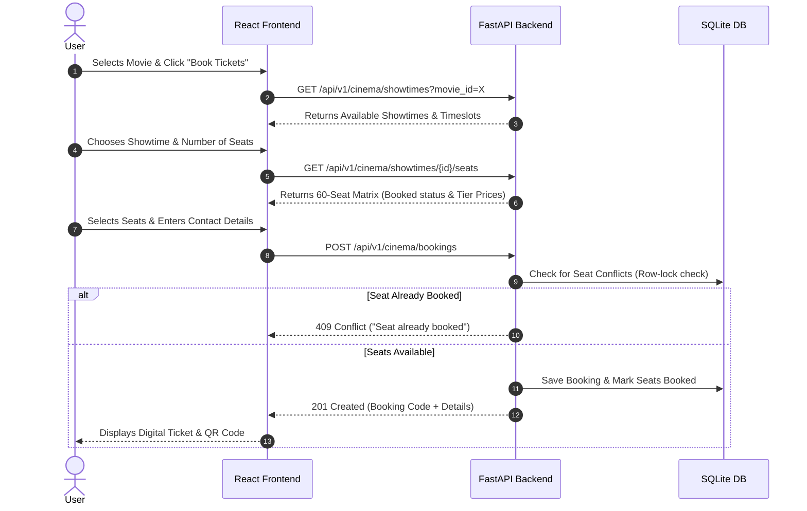

# 🎬 Movie Ticket Booking System

A full-stack, modern cinema ticket booking web application designed for multi-theater hall management (**Oberoi Mall Cineplex** & **Infinity Mall Cineplex**). Features interactive seat selection with tiered pricing, double-booking conflict prevention, automated database seeding, and digital ticket generation with QR codes.

---

## ✨ Features

- **🏛️ Dual Cinema Hall Management**:
  - Filter movies and showtimes specifically for **Oberoi Mall Cineplex** (Laser 4K Atmos) or **Infinity Mall Cineplex** (IMAX & Dolby Surround).
- **💺 Interactive 60-Seat Matrix**:
  - Real-time seat selection grid (Rows A–F, Columns 1–10).
  - **Tiered Pricing**:
    - **Rows A & B (VIP Recliner)**: Base Price + ₹120
    - **Rows C & D (Prime Executive)**: Base Price + ₹50
    - **Rows E & F (Classic Standard)**: Base Price
- **🛡️ Concurrency & Double-Booking Protection**:
  - Backend atomic seat validation ensures no two customers can reserve the same seat simultaneously (returns HTTP 409 Conflict).
- **🎫 Digital Ticket & QR Code Generation**:
  - Instant digital ticket generation with unique booking reference codes (e.g., `OBR-123456`, `INF-654321`) and scanned QR codes upon booking.
- **📋 My Bookings & Cancellation**:
  - View past booking history, review digital tickets anytime, or cancel existing reservations to free up seats.
- **🔍 Movie Discovery & Search**:
  - Search movies by title, filter by cinema hall, or browse by genre.
- **⚡ Auto-Seeding Database**:
  - Automatically seeds cinema halls, popular movies (*Dune: Part Two*, *Oppenheimer*, etc.), and showtimes on first launch.

---

## 🛠️ Tech Stack

### Frontend
- **Framework**: [React 18](https://react.dev/) + [Vite](https://vitejs.dev/)
- **Icons**: [Lucide React](https://lucide.dev/)
- **Styling**: Modern Vanilla CSS & Tailwind CSS tokens (Dark mode, glassmorphism, responsive micro-animations)
- **HTTP Client**: Native Fetch API

### Backend
- **Framework**: [FastAPI](https://fastapi.tiangolo.com/) (Python 3.12+)
- **ORM**: [SQLAlchemy 2.0](https://www.sqlalchemy.org/)
- **Database**: [SQLite](https://www.sqlite.org/) (configurable to MySQL / PostgreSQL)
- **Validation**: [Pydantic v2](https://docs.pydantic.dev/)
- **Server**: [Uvicorn](https://www.uvicorn.org/)
- **Package Management**: [uv](https://github.com/astral-sh/uv)

---

## 📂 Project Structure

```text
Movie-Ticket-System/
├── backend/
│   ├── core/                  # App configuration & environment settings (.env)
│   ├── db/                    # SQLAlchemy database engine & auto-seeding script
│   │   ├── database.py        # Database session & engine setup
│   │   └── seed.py            # Pre-populates halls, movies, and showtimes
│   ├── models/                # SQLAlchemy ORM models (CinemaHall, Movie, Showtime, Booking)
│   ├── routers/               # API endpoint routes (/cinema, /events, /bookings)
│   ├── schemas/               # Pydantic validation schemas
│   ├── events.db              # SQLite database file (local storage)
│   ├── main.py                # FastAPI application entry point & CORS
│   ├── pyproject.toml         # Python dependencies
│   └── uv.lock                # Locked dependency tree
├── frontend/
│   ├── public/                # Static public assets (icons, logos)
│   ├── src/
│   │   ├── components/        # Reusable React components
│   │   │   ├── Navbar.jsx               # Header, search, hall filters & my bookings
│   │   │   ├── HeroBanner.jsx           # Featured movie spotlight
│   │   │   ├── MovieGrid.jsx            # Responsive movie catalog grid
│   │   │   ├── MovieCard.jsx            # Individual movie card with poster & metadata
│   │   │   ├── ShowtimePickerModal.jsx  # Date & theater showtime picker
│   │   │   ├── SeatCountModal.jsx       # "How many seats?" selection modal
│   │   │   ├── SeatMapModal.jsx         # Interactive 60-seat layout & user form
│   │   │   ├── BookingSuccessPage.jsx   # Digital ticket with QR code
│   │   │   ├── DigitalTicketModal.jsx   # Quick ticket preview modal
│   │   │   └── MyBookingsModal.jsx      # Booking history and ticket cancellation
│   │   ├── api.js             # API service for FastAPI communication
│   │   ├── App.jsx            # Main app coordinator
│   │   ├── index.css          # Design system, glassmorphism & color variables
│   │   └── main.jsx           # React DOM mounting
│   ├── package.json           # Node.js dependencies & scripts
│   └── vite.config.js         # Vite build configuration
├── .gitignore                 # Root gitignore excluding heavy / cached files
└── README.md                  # Project documentation
```

---

## 🚀 Getting Started

### Prerequisites
- **Node.js** (v18 or higher)
- **Python** (v3.11 or higher)
- Optional: [`uv`](https://github.com/astral-sh/uv) (recommended fast Python package installer)

---

### 1. Backend Setup

1. Open a terminal and navigate to `backend`:
   ```bash
   cd backend
   ```

2. **Option A (Using `uv` - Recommended)**:
   ```bash
   uv run uvicorn main:app --reload
   ```

   **Option B (Standard Python Virtual Environment)**:
   ```bash
   python -m venv .venv
   # Windows:
   .venv\Scripts\activate
   # macOS/Linux:
   source .venv/bin/activate

   pip install fastapi uvicorn sqlalchemy pydantic python-dotenv
   uvicorn main:app --reload --port 8000
   ```

3. The backend will start on:
   - **API Server**: `http://localhost:8000`
   - **Interactive API Docs (Swagger UI)**: `http://localhost:8000/docs`
   - **ReDoc**: `http://localhost:8000/redoc`

---

### 2. Frontend Setup

1. Open a second terminal and navigate to `frontend`:
   ```bash
   cd frontend
   ```

2. Install dependencies:
   ```bash
   npm install
   ```

3. Start the development server:
   ```bash
   npm run dev
   ```

4. Open your browser at:
   - **Local URL**: `http://localhost:3000`

---

## 🔌 API Endpoints Summary

| Method | Endpoint | Description |
| :--- | :--- | :--- |
| `GET` | `/api/v1/cinema/halls` | List all cinema halls (Oberoi & Infinity) |
| `GET` | `/api/v1/cinema/movies` | Get now showing movies (filter by hall, genre, search) |
| `GET` | `/api/v1/cinema/movies/{id}` | Get detailed movie info |
| `GET` | `/api/v1/cinema/showtimes` | List showtimes filtered by movie, date, or hall |
| `GET` | `/api/v1/cinema/showtimes/{id}/seats` | Fetch 60-seat matrix with booked/available status & pricing |
| `POST` | `/api/v1/cinema/bookings` | Book tickets (with seat conflict checking & code generation) |
| `GET` | `/api/v1/cinema/bookings` | Retrieve user bookings |
| `POST` | `/api/v1/cinema/bookings/{id}/cancel` | Cancel an active booking and release seats |

---

## 💡 How the Booking Flow Works



---

## 📄 License

This project is open-source and available under the [MIT License](LICENSE).
